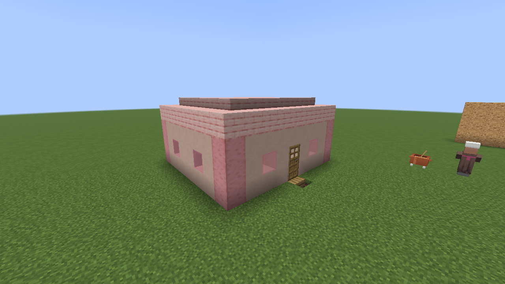
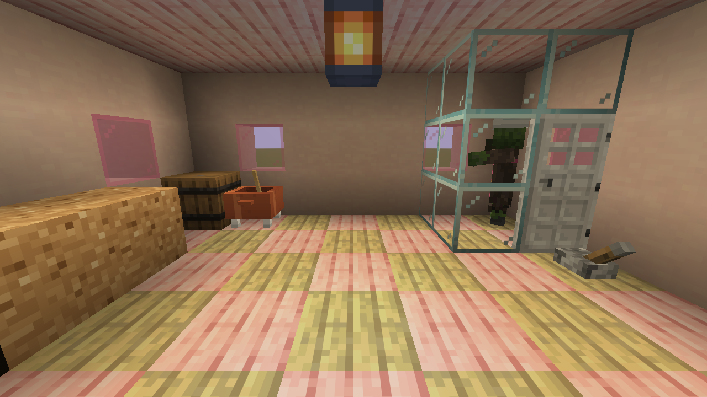
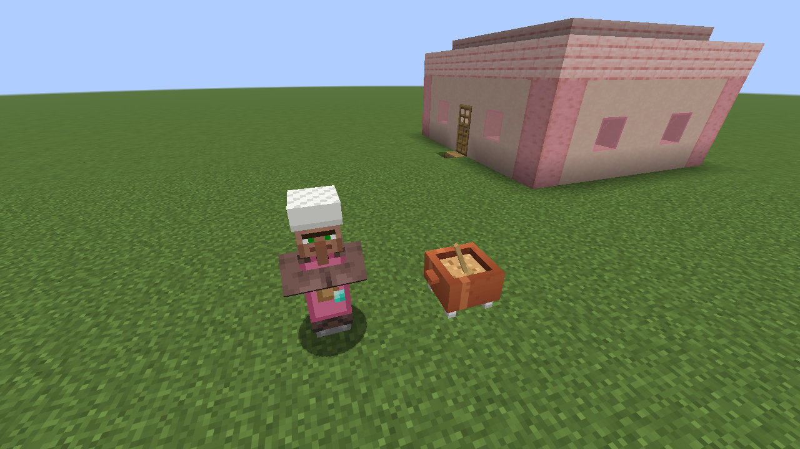
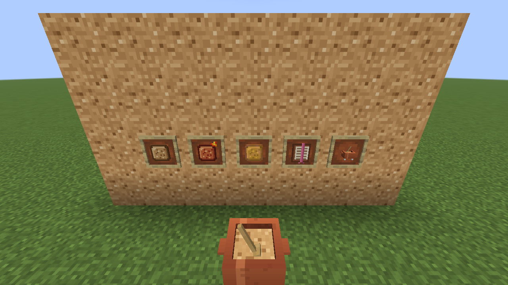
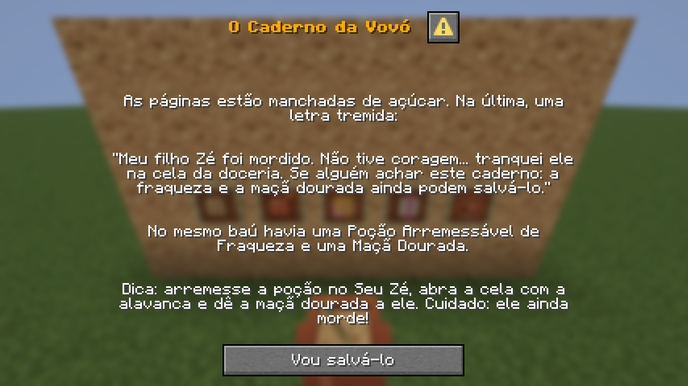
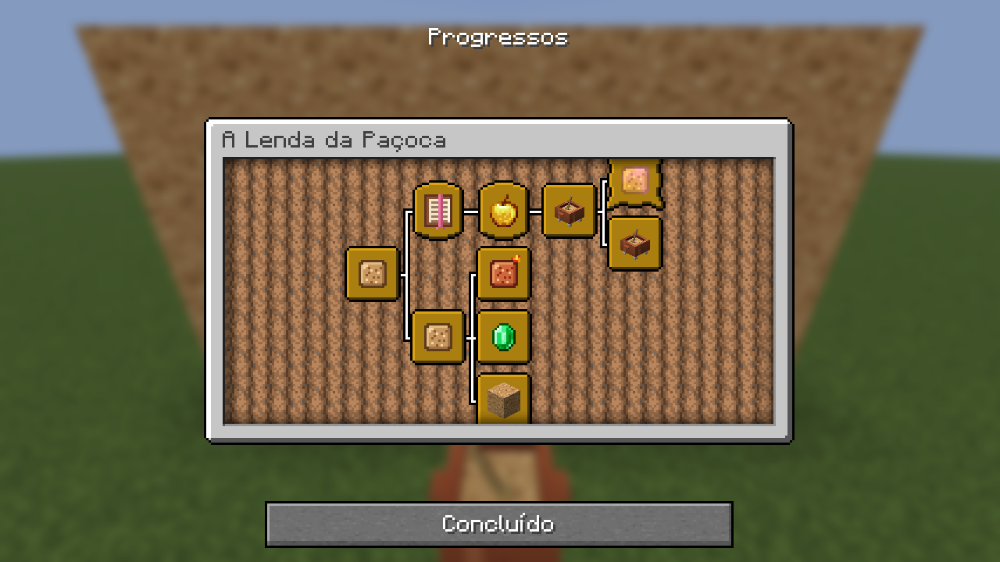

# Paçoca — meu primeiro mod de Minecraft

| | |
|---|---|
|  |  |
|  |  |
|  |  |

Mod para **Minecraft Java 26.3** com **Fabric** que adiciona a **Paçoca**: um docinho que
alimenta 2 pernis, pode ser comido mesmo de barriga cheia e dá **Velocidade I por 10 s**.

- Receita (sem formato fixo): trigo + açúcar + sementes de cacau → 2 paçocas
- No modo criativo: aba "Comidas e Bebidas"

E o **Bloco de Paçoca**: 9 paçocas na bancada viram um bloco (e o bloco volta a ser 9 paçocas).
Quebra rápido com pá e fica na aba "Blocos de Construção".

E a **Paçoca Picante** (paçoca + pó de blaze): ao comer, solta fogo e fumaça, te lança
para o alto e dá Queda Lenta para você pousar sem dano.

E os **fazendeiros** (aldeões de nível 1) podem vender 4 paçocas por 1 esmeralda.

## A Lenda da Paçoca

Uma história contada em conquistas (aba própria na tela de Progressos) e diálogos:

1. Pegue uma paçoca: começa a lenda.
2. Nas **vilas de planície** pode surgir uma **Doceria** (casinha de telhado rosa). No baú está o
   *Caderno de Receitas da Vovó*, uma Maçã Dourada e uma Poção Arremessável de Fraqueza.
3. Na cela de vidro está o **Seu Zé**, o último Doceiro, transformado em aldeão zumbi.
   Arremesse a poção nele, abra a cela com a alavanca e dê a maçã dourada.
4. Curado, ele volta a trabalhar na **Panela de Doces** e vende Paçoca Picante, bolo, maçã dourada
   e, no nível Mestre, a **Paçoca Dourada**.

A Panela de Doces só funciona com Doceiros: aldeões desempregados a ignoram.

Para testar rápido no criativo: `/place template pacoca:village/plains/doceria` coloca a doceria
na sua frente, e `/locate structure minecraft:village_plains` acha uma vila de planície.

## Pré-requisitos

- JDK 25 (ex.: Eclipse Temurin 25). Se `java -version` não mostrar 25, aponte o `JAVA_HOME`:
  `$env:JAVA_HOME = "C:\Program Files\Eclipse Adoptium\jdk-25.0.5.8-hotspot"` (PowerShell)
- Não precisa instalar Gradle: o `gradlew` baixa a versão certa sozinho.

## Rodar no jogo (cliente de desenvolvimento)

```powershell
.\gradlew runClient
```

Abre um Minecraft já com o mod e o Fabric API carregados (o mundo de teste fica em `run/`).

## Tirar os prints de novo

```powershell
.gradlew runClientGameTest
```

Um teste automático (`src/gametest`) abre o jogo, monta as cenas com comandos e salva os prints em
`build/run/clientGameTest/screenshots`. Se algo quebrar no mod, o teste falha.

## Gerar o `.jar`

```powershell
.\gradlew build
```

O mod sai em `build/libs/pacoca-1.0.0.jar` (o `-sources.jar` é só o código-fonte).
Para usar no seu Minecraft normal, copie esse `.jar` para `%APPDATA%\.minecraft\mods`
junto com o Fabric API e abra o perfil **fabric-loader 26.3** no launcher.

## Onde fica cada coisa

| Arquivo | Para quê |
| --- | --- |
| `src/main/java/com/fernando/pacoca/PacocaMod.java` | Ponto de entrada (`onInitialize`) |
| `src/main/java/com/fernando/pacoca/ModItems.java` | Registro do item, comida e efeito |
| `src/main/java/com/fernando/pacoca/ModBlocks.java` | Registro do bloco e do item do bloco |
| `src/main/java/com/fernando/pacoca/PacocaPicanteItem.java` | Item com comportamento próprio (herda de `Item`) |
| `src/main/java/com/fernando/pacoca/ModVillagers.java` | Profissão Doceiro e o POI da Panela de Doces |
| `src/main/resources/data/pacoca/structure/` | A Doceria (`.nbt`, gerada por script) |
| `src/main/resources/data/minecraft/worldgen/template_pool/` | Pool de casas da vila de planície, com a Doceria incluída |
| `src/main/resources/data/pacoca/trade_set/` e `villager_trade/` | Trocas do Doceiro por nível |
| `src/main/resources/data/pacoca/advancement/lenda/` | Árvore de conquistas da lenda |
| `src/main/resources/data/pacoca/dialog/` e `function/` | Capítulos da história e os comandos que os mostram |
| `tools/` | Scripts Node que geraram a Doceria, as texturas, os diálogos e as conquistas |

Para regerar a Doceria depois de editar o script:
`node tools/gerar-doceria.js tools/nbt.js src/main/resources/data/pacoca/structure/village/plains/doceria.nbt`.
Os scripts de lore e conquistas escrevem na pasta atual: rode-os dentro de `src/main/resources/data/pacoca`.
| `src/main/resources/fabric.mod.json` | Manifesto do mod (tipo um `package.json`) |
| `src/main/resources/assets/pacoca/` | Textura, modelo e traduções (lado do cliente) |
| `src/main/resources/data/pacoca/recipe/` | Receitas de crafting (lado do servidor) |
| `src/main/resources/data/pacoca/loot_table/` | O que o bloco solta ao ser quebrado |
| `src/main/resources/data/pacoca/villager_trade/` | Trocas de aldeão (o que ele quer e o que dá) |
| `src/main/resources/data/minecraft/tags/` | Tags do jogo que o mod complementa (ex.: "minerável com pá", trocas do fazendeiro) |
| `gradle.properties` | Versões do Minecraft, Fabric Loader e Fabric API |
